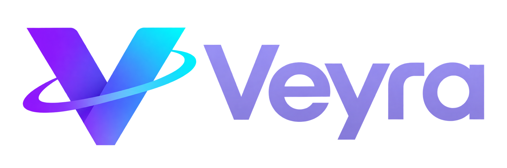

<div align="center">



**Motion for your universe.**

Schlanke, sichere Video-Hintergründe für den Windows-Desktop.<br>
Kein Browser, keine Skripte, kein Netzwerk¹ – nur dein Video, hardwarebeschleunigt hinter deinen Desktop-Symbolen.


</div>

---

## Features

- 🎬 **Video-Wallpaper** – MP4/H.264, H.265/HEVC, VP9, AV1 (alles, was Windows' Media Foundation kann), in Endlosschleife
- ⚡ **Hardware-Dekodierung** über die GPU – Ton wird nie dekodiert
- 🚀 **Zero-Copy** – dekodierte Bilder bleiben im Grafikspeicher und werden direkt gezeichnet (DX12)
- 🖥️ **Multi-Monitor** – pro Bildschirm ein eigenes Video oder ein Video für alle (wird dann nur einmal dekodiert)
- ⏸️ **Auto-Pause** bei Vollbild-Spielen/-Videos, maximierten Fenstern (optional), Akkubetrieb und Sperrbildschirm
- 🔊 **Audio-reaktiv** – Effekte `pulse`, `glow` und `chroma` reagieren auf den Systemsound (WASAPI-Loopback)
- 🖼️ **Einstellungsfenster** – Monitore in echter Anordnung mit Vorschau, Video per Klick, Dateidialog oder Drag & Drop
- 📚 **Video-Bibliothek** – ein Ordner (Standard: „Videos“), dessen Videos mit Vorschaubild zur Auswahl stehen
- ⏸️ **Pause bei ausgeschaltetem Bildschirm** – spart Strom, wenn die Monitore in den Standby gehen
- 🧭 **Tray-Icon** mit Menü (passt sich heller/dunkler Taskleiste an) und **Autostart** mit Windows
- 📌 **An Start und Taskleiste anheften** – über einen optionalen Startmenü-Eintrag
- 🕐 **Widgets** – Uhr, **Flight Control**, **Deep Space Clock**, **Signal Analyzer** und **DSN Now** über dem
  Video, in der Raumfahrt-Schrift Orbitron, jedes Widget an einer von 9 Positionen
- 🚀 **Flight Control** – der nächste Raketenstart weltweit als Mission-Control-Modul: Countdown mit
  *Terminal Count* und *Liftoff*-Effekt, die Rakete als Sensor-Scan, Mission-Patch im Instrumenten-Ring
- 🛰️ **Deep Space Clock** – UTC, Julianisches Datum, Sternzeit, Mars-Zeit (MTC) und Ortszeit samt Sol der Rover
  Curiosity und Perseverance, mit Zifferblatt für Erdtag und Marssol – rein rechnerisch, ohne Netzwerk
- 📈 **Signal Analyzer** – der Systemsound als Messgerät mit grün nachleuchtendem Phosphor-Schirm:
  Spektrum (48 Bänder mit Spitzenwerten), getriggertes Oszilloskop oder XY-Goniometer
- 📡 **DSN Now** – live aus dem NASA Deep Space Network: welche Antenne in Goldstone, Madrid und Canberra gerade
  mit welcher Raumsonde funkt, mit Datenrate, Signallaufzeit und Entfernung auf einer Lichtlaufzeit-Skala
- 🔒 **Sicher by Design** – kein Browser, keine Skripte, kein Netzwerk¹, keine Adminrechte
- 🪶 **Eine einzige EXE** – keine DLLs, keine Installation

Linux ist architektonisch vorbereitet (siehe [docs/ARCHITEKTUR.md](docs/ARCHITEKTUR.md)).

¹ Einzige Ausnahmen: die Widgets *Flight Control* und *DSN Now* – beide standardmäßig aus. Ist Flight Control
aktiv, fragt Veyra alle 15 Minuten die öffentlichen Startdaten der [Launch Library 2](https://thespacedevs.com/llapi)
ab und lädt Raketenfoto und Mission-Patch der nächsten Starts aus deren Bildablage (zwei fest eingebaute
HTTPS-Adressen, nur lesend). DSN Now holt einmal pro Minute den öffentlichen Antennenstatus von
[eyes.nasa.gov](https://eyes.nasa.gov/dsn/dsn.html) (eine fest eingebaute Adresse, nur lesend).
Ohne diese beiden Widgets gibt es keinen einzigen Netzwerkaufruf.

## Warum Veyra?

Viele Wallpaper-Programme bringen einen kompletten Browser, Skript-Engines und Online-Workshops mit –
das kostet RAM, CPU und vergrößert die Angriffsfläche. Veyra macht genau eine Sache:
Videos effizient als Hintergrund abspielen.

| | Veyra |
|---|---|
| Laufzeit | Kein Browser, nur Videodateien |
| Fremder Code | Kein Skripting, keine Plugins, keine Downloads |
| Netzwerk | Keiner – außer du schaltest Flight Control oder DSN Now ein (dann nur fest eingebaute Adressen) |
| Codebasis | ~9.300 Zeilen Rust, 11 direkte Abhängigkeiten |
| Rechenlast | Zeichnet nur, wenn ein neues Videobild fällig ist, Bilder verlassen nie den Grafikspeicher – und pausiert, wenn niemand hinsieht |

## Download

Fertige Builds gibt es unter [Releases](https://github.com/w3ssy/veyra/releases) – einfach `veyra.exe` herunterladen
und starten (keine Installation, keine Adminrechte). Die `.sha256`-Datei daneben enthält die Prüfsumme.

## Bauen (Windows)

1. Rust installieren: <https://rustup.rs> (Standard-Toolchain `x86_64-pc-windows-msvc`, mindestens Rust 1.95).
   Dafür werden die *Visual Studio Build Tools* mit „Desktopentwicklung mit C++“ benötigt.
2. Repository klonen und bauen:

   ```powershell
   git clone https://github.com/w3ssy/veyra.git
   cd veyra
   cargo build --release
   ```

3. Die fertige Datei liegt unter `target\release\veyra.exe` (eine einzige EXE, keine DLLs).

Zum Entwickeln mit Konsolenausgabe: `cargo run` (Debug-Build zeigt Logs im Terminal).
Ausführlichere Logs: Umgebungsvariable `VEYRA_LOG=debug` setzen.

Logo oder Symbol geändert? Die Icons in `assets/` neu erzeugen mit `python assets/make_icons.py`
(benötigt Pillow, NumPy, SciPy).

## Benutzen

1. `veyra.exe` starten – es erscheint ein Symbol im Infobereich der Taskleiste.
2. Rechtsklick → **Einstellungen…** öffnet das Einstellungsfenster:
   - oben deine Monitore in ihrer echten Anordnung, mit Vorschau des jeweiligen Videos,
   - „Ein Video für alle Monitore“ abwählen, um jedem Monitor ein eigenes Video zu geben,
   - Video per **Durchsuchen…**, Klick in der **Bibliothek** oder per **Drag & Drop** auf einen Monitor zuweisen,
   - unter **Widgets**: Uhr, Flight Control, Deep Space Clock, Signal Analyzer und DSN Now einschalten und per
     Klick auf den Mini-Monitor platzieren,
   - unter **Allgemein**: Autostart, Pausen-Regeln, Bildrate, Grafikkarte, Audio-Reaktion.
3. **Speichern** (oder Strg+S) – Veyra übernimmt die Änderung sofort.

**An Start oder Taskleiste anheften:** Einstellungen → Allgemein → **Im Startmenü anzeigen** aktivieren,
dann im Startmenü unter „Alle Apps“ Rechtsklick auf **Veyra** → „An Start anheften“ bzw. „An Taskleiste anheften“.
Alternativ das offene Einstellungsfenster in der Taskleiste per Rechtsklick anheften. Ein Klick darauf öffnet
die Einstellungen und startet Veyra, falls es nicht läuft; ein erneuter Start von `veyra.exe` ebenso.

Wer lieber eine Textdatei bearbeitet: Tray → **config.toml bearbeiten…** öffnet `%APPDATA%\Veyra\config.toml`;
Änderungen werden nach ~1 s automatisch übernommen.

```toml
[library]
folder = 'D:\Wallpaper'  # Ordner für die Bibliothek im Einstellungsfenster (leer = "Videos")

[widgets]
monitor = "primary"      # Widgets auf dem Hauptmonitor ("all" oder Nummer geht auch)
scale = 1.0

[widgets.clock]
enabled = true
position = "center"      # top-left, top, top-right, left, center, right, bottom-left, bottom, bottom-right

[widgets.flight_control]
enabled = true
position = "bottom-left"

[widgets.deep_space_clock]
enabled = true
position = "top-right"
longitude = 13.40        # Längengrad für die Ortssternzeit (weglassen = Greenwich)
mars = true              # Mars-Zeit und Rover

[widgets.signal_analyzer]
enabled = true
position = "bottom-right"
mode = "spectrum"        # "spectrum", "wave" (Oszilloskop) oder "xy" (Goniometer)

[widgets.dsn]
enabled = true
position = "top-left"

[[wallpaper]]
monitor = "all"
video = 'C:\Users\<name>\Videos\regen.mp4'
fit = "cover"
effect = "pulse"
intensity = 1.0

[[wallpaper]]            # Monitor 2 bekommt ein eigenes Video
monitor = 2
video = 'D:\Wallpaper\stadt-nacht.mp4'
effect = "none"
```

Monitore werden **von links nach rechts** ab 1 gezählt; die Zuordnung steht beim Start im Log
(Tray → **Ordner mit Log öffnen** → `veyra.log`). Doppelklick aufs Tray-Symbol pausiert/setzt fort.

> **Hinweis:** Veyra liefert keine Videos mit. Verwende nur Videos, an denen du die nötigen Rechte hast.

### Tipps für minimale Last

- Videos in der **Auflösung des Monitors** und mit **30 fps** kodieren – das spart mehr als jede Einstellung.
  Beispiel mit ffmpeg: `ffmpeg -i in.mp4 -an -vf scale=2560:-2,fps=30 -c:v libx264 -crf 20 out.mp4`
  (`-an` entfernt die Tonspur).
- H.264 oder HEVC werden praktisch überall in Hardware dekodiert; AV1 nur auf neueren GPUs.
- `max_fps = 30` und `gpu = "low"` (integrierte GPU) sind auf Laptops die sparsamste Wahl.
- **Desktop-PC mit Grafikkarte:** Hängen die Monitore an der dedizierten GPU, ist `gpu = "high"` meist deutlich
  sparsamer als `"low"` – sonst rechnet die schwache iGPU, und Windows kopiert jedes Bild zwischen den Grafikkarten.
- Im Log steht, welche GPU gewählt wurde und ob Zero-Copy aktiv ist („Zero-Copy aktiv“ bzw. „über Arbeitsspeicher“).

## Sicherheit prüfen

```powershell
cargo install cargo-audit
cargo audit          # bekannte Schwachstellen in Abhängigkeiten
```

Siehe Abschnitt „Sicherheitsmodell“ in [docs/ARCHITEKTUR.md](docs/ARCHITEKTUR.md).

## Stand

Veyra ist in der **Beta** (v0.3). Getestet unter Windows 11 24H2 mit AMD- und NVIDIA-Grafik; jeder Push
wird per GitHub Actions mit Clippy und Unit-Tests geprüft.
Je nach Windows-Version und Grafiktreiber kann es noch Ecken geben – v. a. bei der Desktop-Einbettung
und bei Zero-Copy (fällt bei Problemen automatisch auf den Weg über den Arbeitsspeicher zurück).
**Windows auf ARM** (Snapdragon) ist ungetestet; die x64-EXE sollte dort über die Windows-Emulation laufen.
Das Log (`%APPDATA%\Veyra\veyra.log`) zeigt, wo es hakt – Issues mit Log-Auszug sind willkommen.

## Mitmachen

Bug-Reports, Ideen und Pull Requests sind willkommen! Bitte vor einem PR `cargo clippy -- -D warnings`
und `cargo test` ausführen (so prüft auch die CI).

## Lizenz

[MIT](LICENSE) © w3ssy

Eingebettete Schrift: [Orbitron](https://github.com/theleagueof/orbitron) © The Orbitron Project Authors,
[SIL Open Font License 1.1](assets/Orbitron-OFL.txt).
Startdaten, Fotos und Mission-Patches: [Launch Library 2](https://thespacedevs.com/llapi) von The Space Devs;
die Rechte an Fotos und Patches liegen bei den jeweiligen Urhebern.
